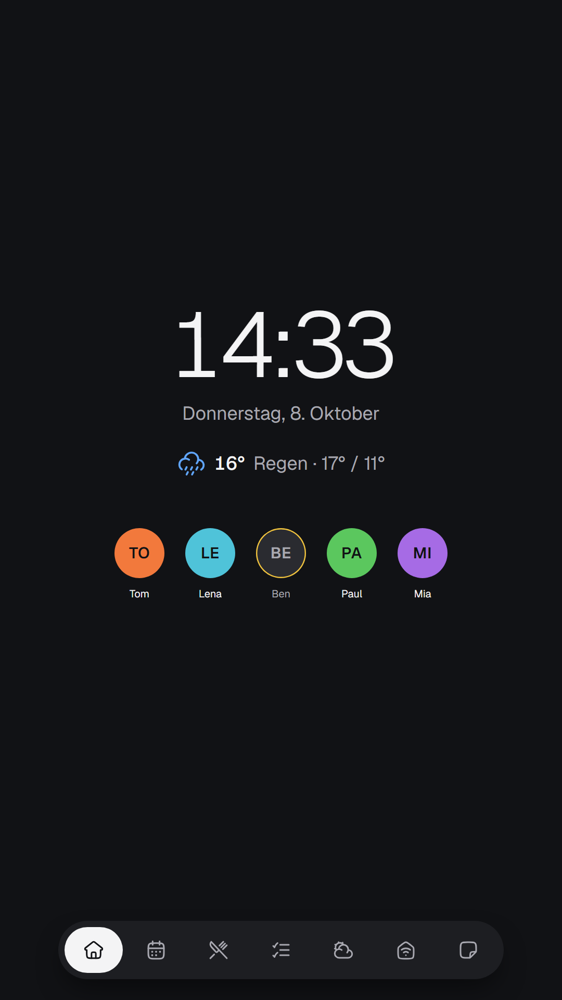
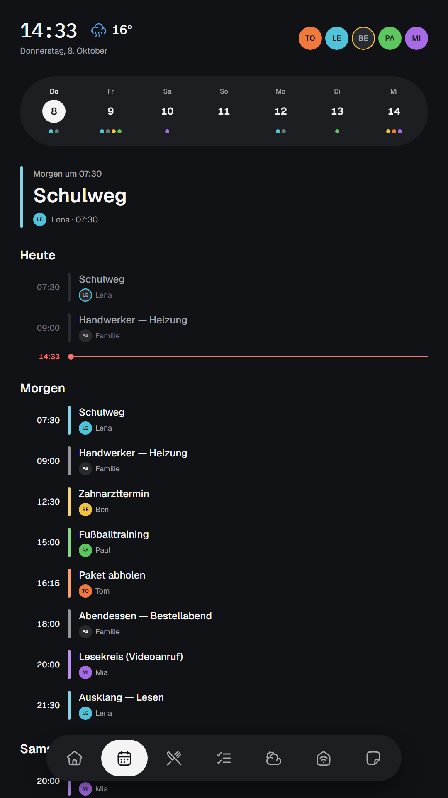
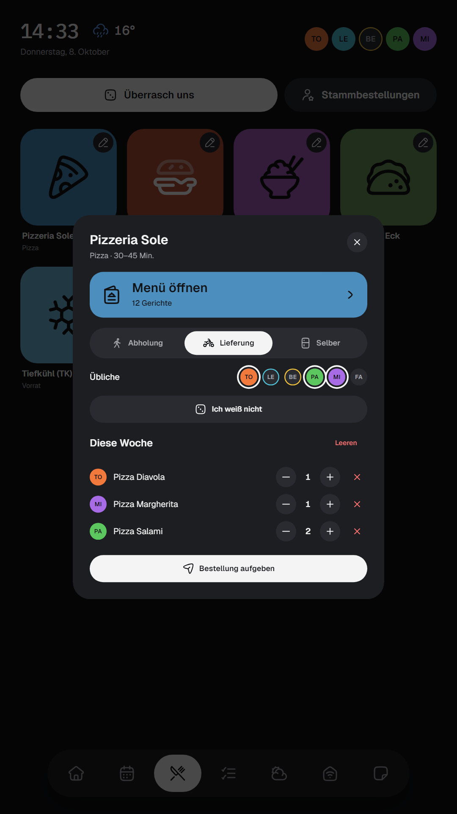
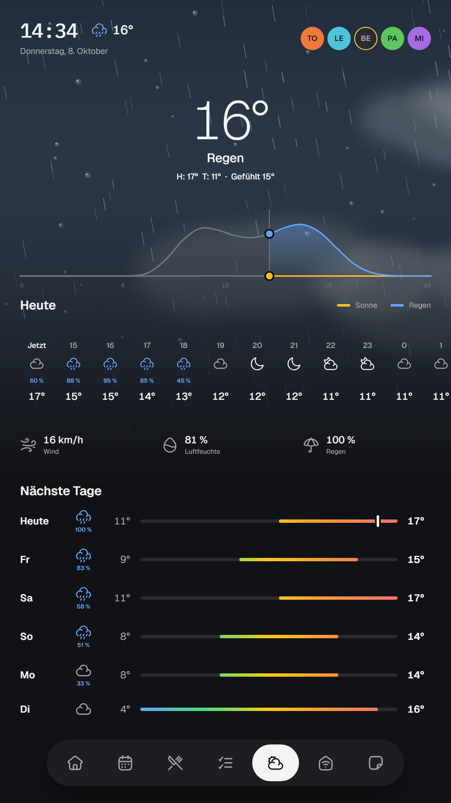
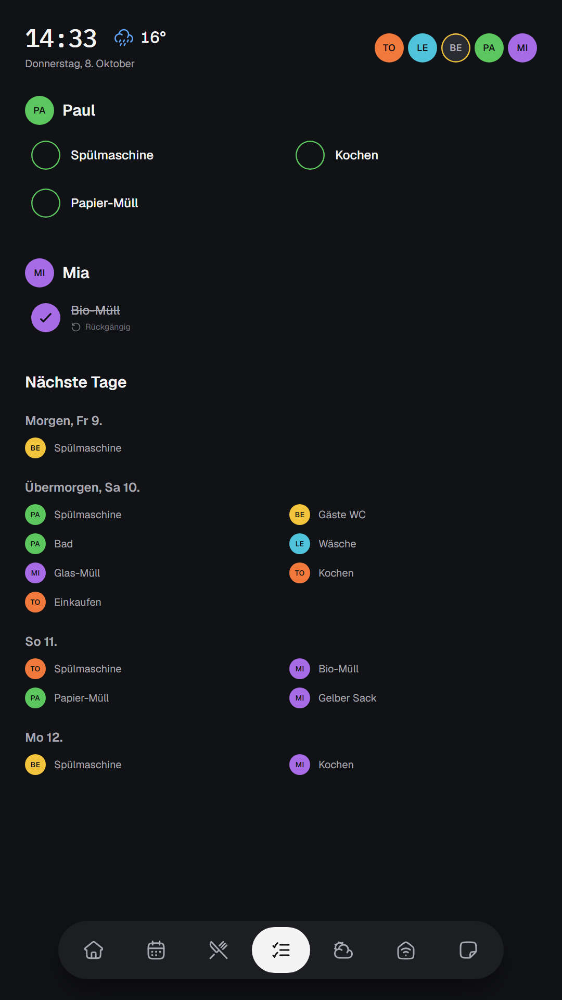
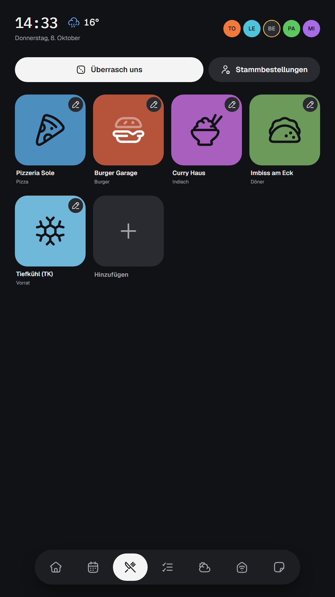
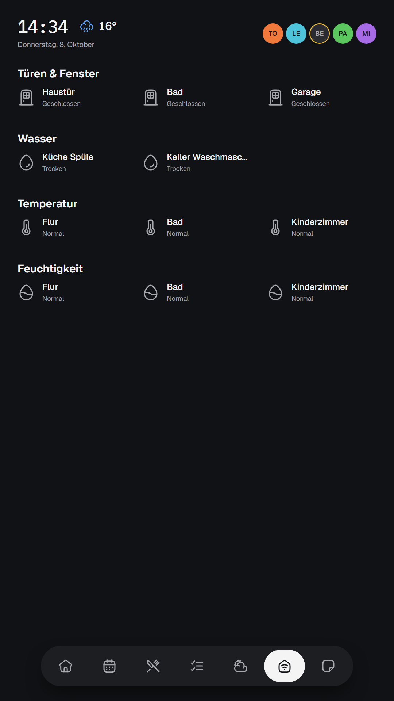
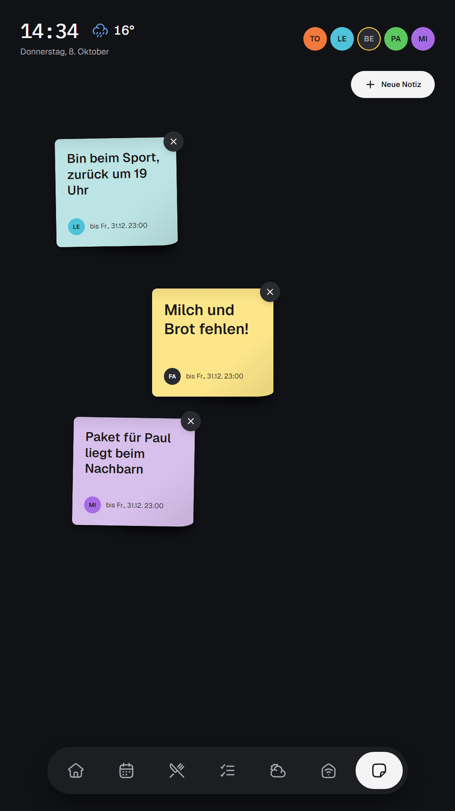

# Home Information Screen — a blueprint, not a codebase

*Deutsche Kurzfassung: [README.de.md](README.de.md)*

A wall-mounted household dashboard on a Raspberry Pi and a portrait touchscreen:
shared calendar, weather, "what are we ordering for dinner", chores, sensors,
and a board of sticky notes. It wakes when someone walks past and sleeps when
nobody is around.

  
  
  
  

  
  
  
  

*All names, appointments, restaurants and notes are invented demo data. The UI is German because the household is.*

I built it in about three weeks in September 2026, working with AI coding agents.
This repository does **not** contain the application code (backend and frontend). It does contain the small, sanitized Pi-side scripts and contracts that are hard to get right without the hardware. It contains what I would hand to a
friend who wanted their own version:

- the **idea** and the screens ([docs/01-concept.md](docs/01-concept.md))
- the **architecture** and the reasoning behind it ([docs/02-architecture.md](docs/02-architecture.md))
- the **design system** that keeps a wall display calm ([docs/03-design-system.md](docs/03-design-system.md))
- the **hardware**: parts, mounting, Wayland rotation and touch ([docs/04-hardware.md](docs/04-hardware.md))
- the **lessons learned**: every failure that cost me hours ([docs/05-lessons-learned.md](docs/05-lessons-learned.md))
- the **prompts** to build it with your own coding agent ([prompts/](prompts/README.md))
- the **admin interface** panel by panel ([docs/06-admin-interface.md](docs/06-admin-interface.md))
- **reference material**: sanitized Pi scripts, systemd units, the API contract, the palette file and invented demo data ([reference/](reference/README.md))

## Why a blueprint instead of code

Software like this is cheap to generate and expensive to fit. Your calendar
server, router, household members, language and wall are different from mine.
Code written for my house would be a starting point you immediately rewrite.
A precise description of *what* to build, *why* each decision was made, and
*where it breaks* transfers better, and your agent can adapt it to your setup.

The prompts here are the actual briefs and constraints I used and refined, with
my hostnames, names and credentials removed.

## How to use this

1. Read the concept and architecture docs (15 minutes).
2. Decide which pieces you want. Everything except the backend and kiosk UI is
   optional: presence, sensors, motion sleep, ordering board.
3. Put [prompts/00-project-brief.md](prompts/00-project-brief.md) into a new
   repo as `CLAUDE.md` / `AGENTS.md` and fill in the placeholders.
4. Work through prompts 01 to 06 in order, one at a time, verifying each
   against its acceptance checks before moving on.
5. Keep a decision log from day one. It is the single most useful file in the
   project (see lessons learned).

## What you need

| | |
|---|---|
| Display | Any 14" or larger Full HD touchscreen, mounted portrait |
| Computer | Raspberry Pi 4B (4 GB) running Raspberry Pi OS Trixie (labwc / Wayland) |
| Server | Anything always-on that runs Docker: a NAS, a mini PC, a spare laptop |
| Optional | PIR motion sensor, a UniFi gateway (presence and sensors), a CalDAV server |
| Skills | Comfortable with a terminal and Docker; the agent does the coding |

## Status

A living household appliance, not a product. Some pieces are deliberately
unfinished (per-person authentication at the screen, chore editing, real
RFID). They are listed honestly in the architecture doc.

## Licence

Dual licence. Text, prompts and screenshots (`README`, `docs/`, `prompts/`): [CC BY 4.0](LICENSE-docs.md). Code and configuration under `reference/`: [MIT](LICENSE). Use them, adapt them, tell me what you built.
